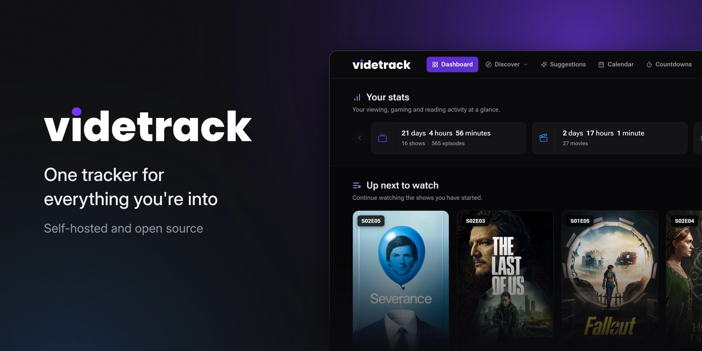
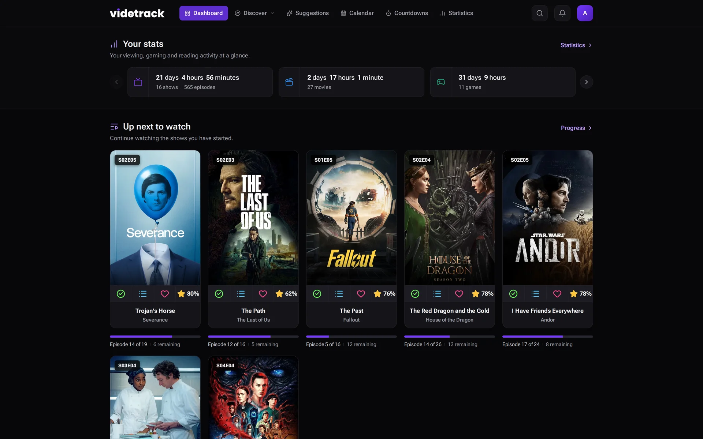
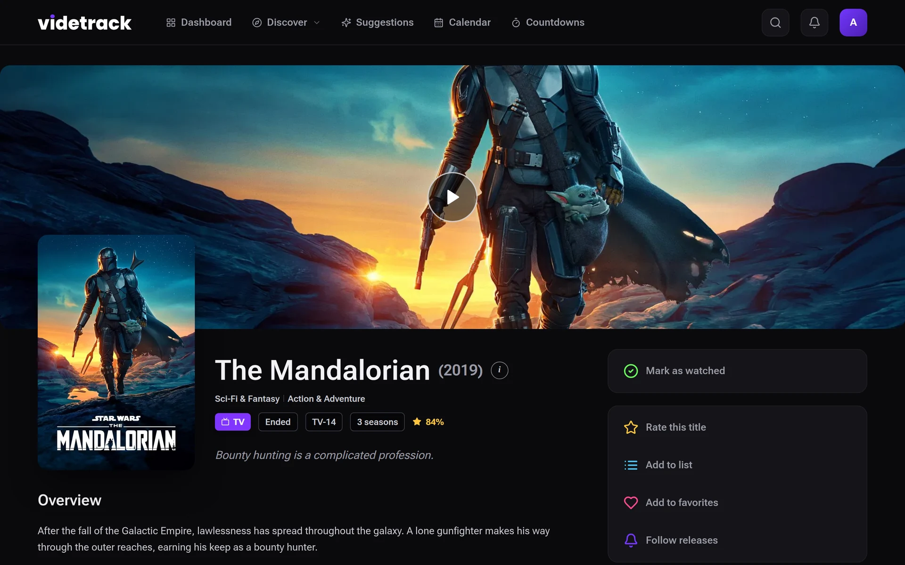
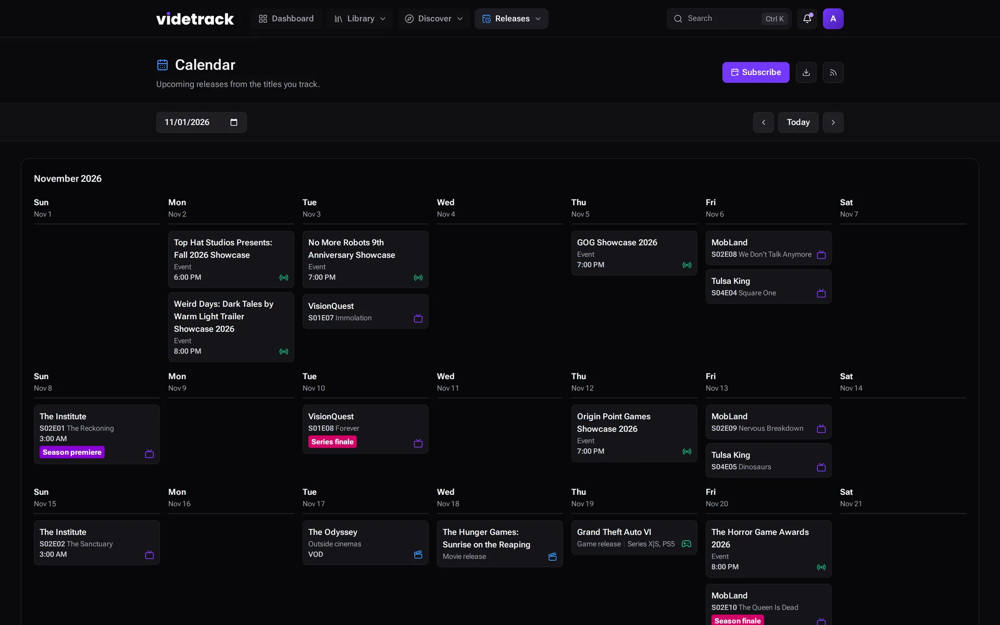
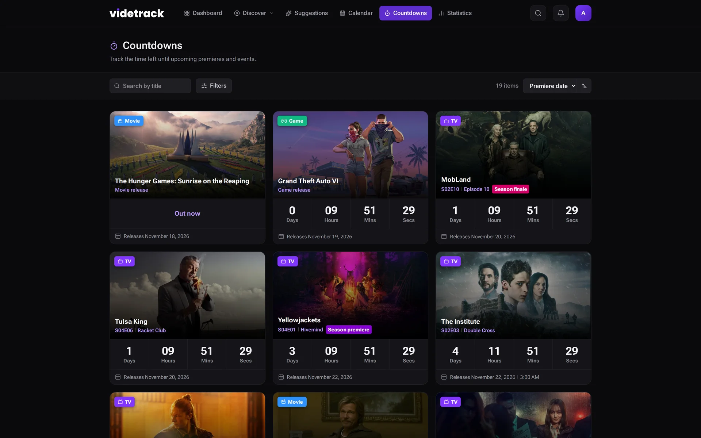
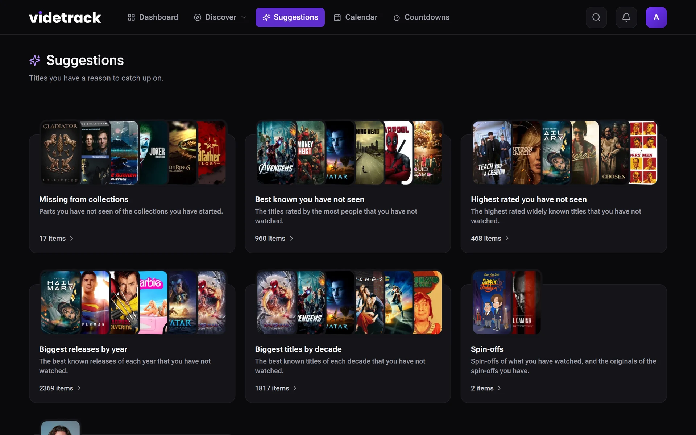
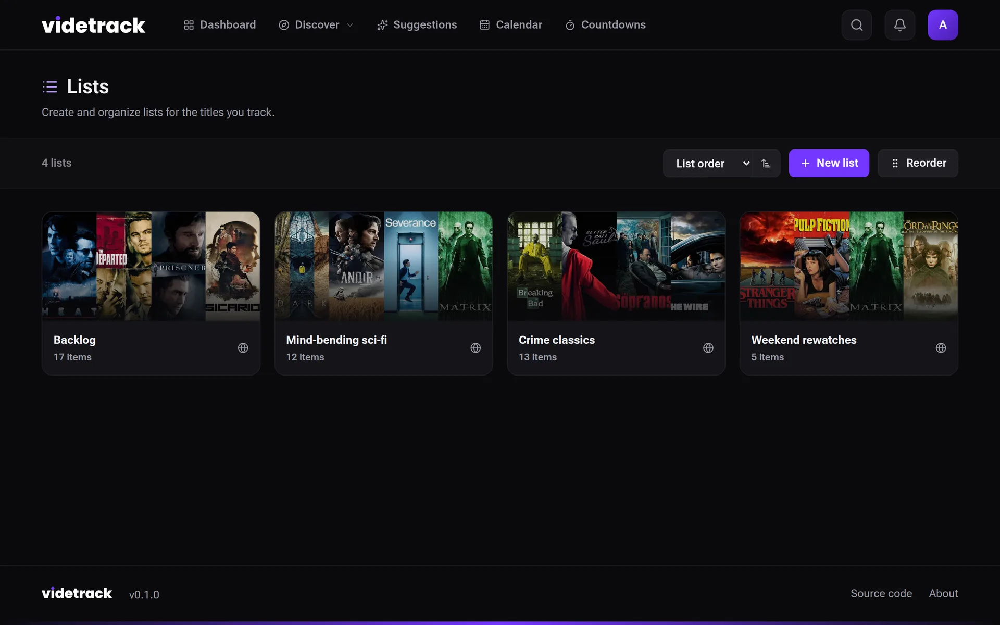
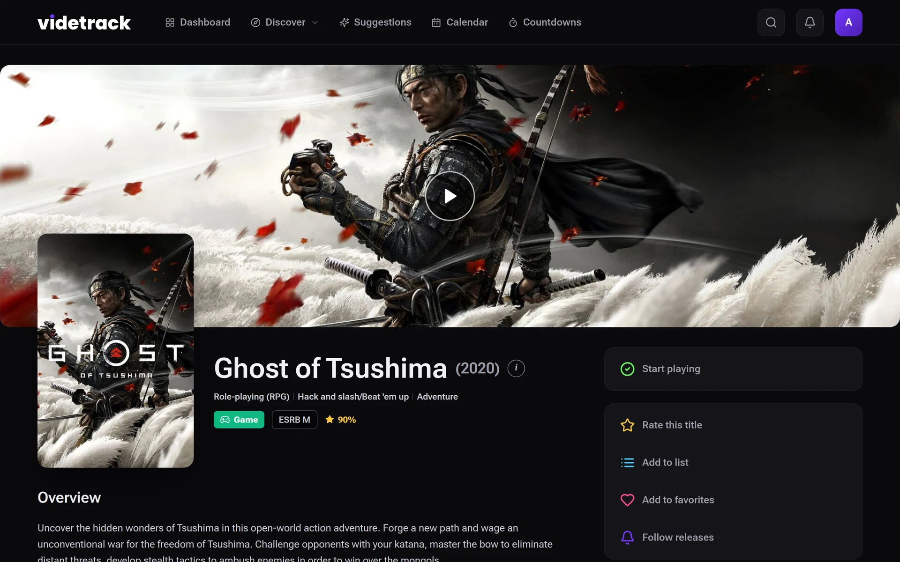
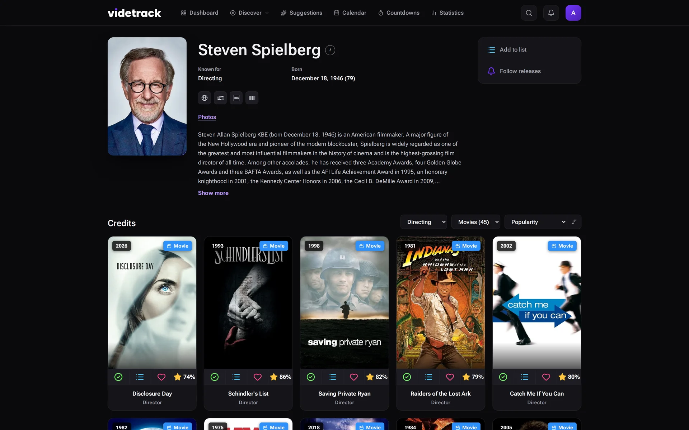

<div align="center">



**A self-hosted tracker for movies, TV, games, books, manga and comics.**

Mark what you watched, played and read. VideTrack remembers where you stopped,
tells you when the next episode or release is out, and keeps all of it on your own server.

[](https://github.com/MaxRzepkowski/VideTrack/actions/workflows/ci.yml)
[](https://github.com/MaxRzepkowski/VideTrack/actions/workflows/codeql.yml)
[](https://github.com/MaxRzepkowski/VideTrack/releases)
[](LICENSE)
<!-- Re-enable once the repo is public (CodeFactor free is public-only, Codecov needs CI to upload coverage):
[](https://www.codefactor.io/repository/github/MaxRzepkowski/VideTrack)
[](https://codecov.io/gh/MaxRzepkowski/VideTrack)
-->


[Features](#features) | [Screenshots](#screenshots) | [Install](#install) | [Documentation](#documentation)

</div>

## Features

- 🎬 Track movies, TV shows, games, books, manga and comics in one place.
- ⏭️ See the next episode of every show you watch, and the games and books you are in the middle of.
- 📅 Follow upcoming releases in a calendar and countdowns, or subscribe to them in your own calendar app or feed reader.
- 🔔 Ring the bell on a title, a person or a studio to hear about new releases, in the app or on Discord.
- ⭐ Rate, favorite and collect titles in a backlog and in your own lists.
- 📊 Keep a full history with rewatches and see how much time went into it.
- ✨ Get suggestions based on what you finished. They wait on their own page and never nag.
- 📥 Import from Trakt, Simkl, IMDb, Goodreads, MyAnimeList, AniList, Kitsu, Steam and more.
- 📡 Log what you watch automatically from Plex, Jellyfin, Emby or Tautulli.
- 📤 Export everything as a backup, as CSV, or as files for IMDb, Letterboxd, Goodreads and MyAnimeList.
- 👥 Give everyone at home their own account, in English or Polish.
- 🐳 Run it as a single Docker container with one SQLite file.

## Screenshots

<table>
  <tr>
    <td width="50%" align="center"><a href="docs/screenshots/dashboard.webp"></a><br /><sub>Dashboard</sub></td>
    <td width="50%" align="center"><a href="docs/screenshots/show.webp"></a><br /><sub>Show page</sub></td>
  </tr>
  <tr>
    <td width="50%" align="center"><a href="docs/screenshots/calendar.webp"></a><br /><sub>Calendar</sub></td>
    <td width="50%" align="center"><a href="docs/screenshots/countdowns.webp"></a><br /><sub>Countdowns</sub></td>
  </tr>
  <tr>
    <td width="50%" align="center"><a href="docs/screenshots/suggestions.webp"></a><br /><sub>Suggestions</sub></td>
    <td width="50%" align="center"><a href="docs/screenshots/lists.webp"></a><br /><sub>Lists</sub></td>
  </tr>
  <tr>
    <td width="50%" align="center"><a href="docs/screenshots/game.webp"></a><br /><sub>Game page</sub></td>
    <td width="50%" align="center"><a href="docs/screenshots/person.webp"></a><br /><sub>Person page</sub></td>
  </tr>
</table>

## Install

You need [Docker](https://docs.docker.com/get-docker/) and a free
[TMDB API key](https://www.themoviedb.org/settings/api).

1. Download [`compose.yaml`](deploy/compose.yaml) and [`env.example`](deploy/env.example) into
   a new folder and rename `env.example` to `.env`.
2. Open `.env` and paste your key after `TMDB_API_KEY=`.
3. Open a terminal in that folder and run:

   ```sh
   docker compose up -d
   ```

Then open `http://localhost:8080` and register. The first account becomes the administrator.

Games, books, manga and comics turn on when you add their keys. See the
[installation guide](docs/install.md) for that, for reverse proxies and for every setting.

## Documentation

- [Installing](docs/install.md) and [upgrading](docs/upgrading.md)
- [Administration](docs/administration.md): user accounts, backup and restore
- [API](docs/api.md) for your own scripts
- [Changelog](CHANGELOG.md)

## AI disclosure

VideTrack is designed and directed by its author: the idea, the feature set, the main screens,
the architecture and its rules, and every product decision. The code, tests and documentation
are written with AI coding agents working to that design. Every change is reviewed and reworked
until it is right, and it has to pass the full set of automated checks (tests, static analysis,
linters and architecture rules) before it lands.

## License

VideTrack is licensed under the [GNU AGPL-3.0](LICENSE).
